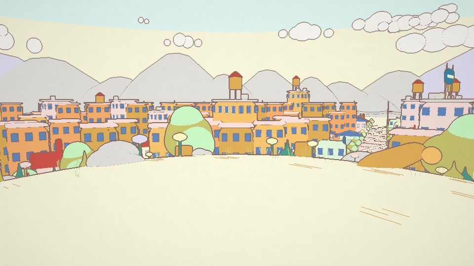
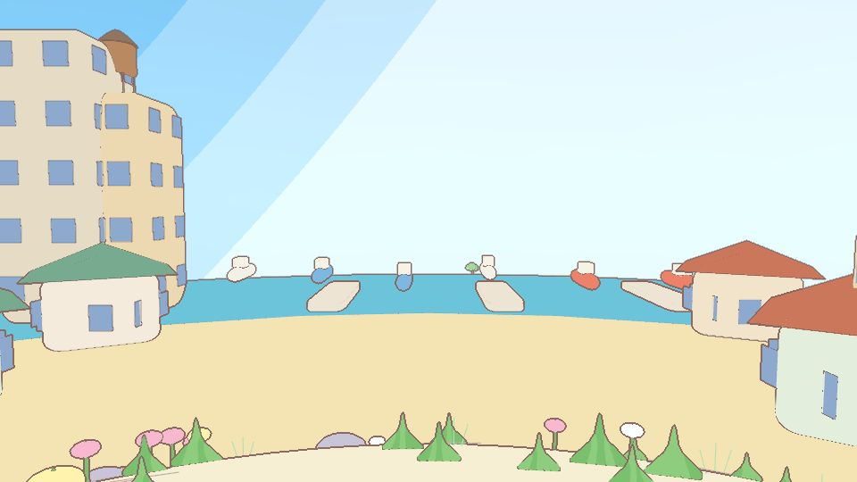
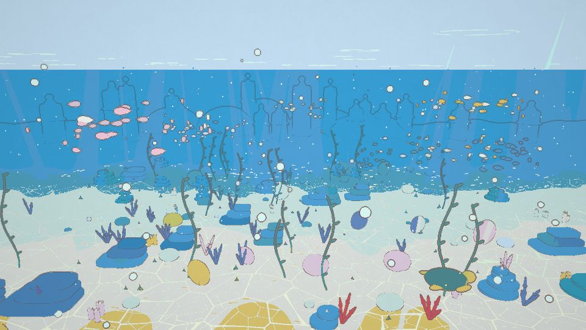
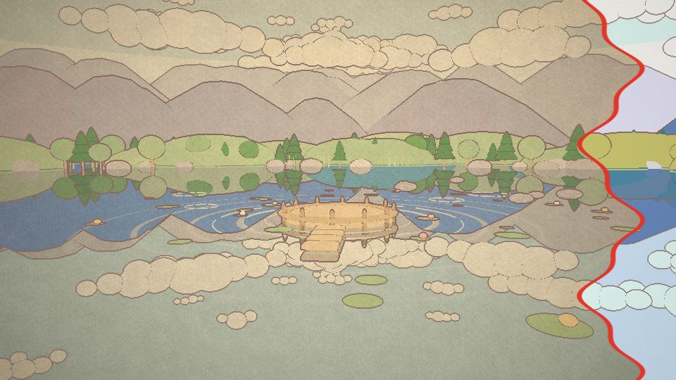
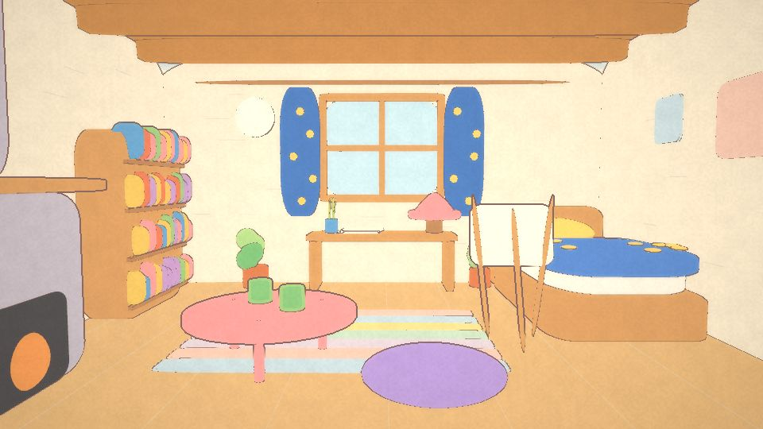
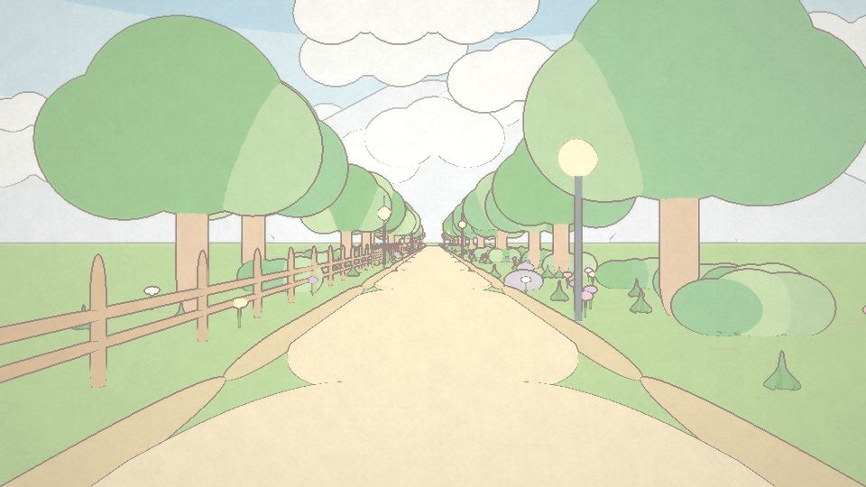

# Sirpeltric · BG references (Three.js)

**Live:** <https://iluztar.github.io/threejs/>

Six background scenes for *Sirpeltric*, one continuous camera journey through anime history (1945 → 1990s → full colour → grey warp).
Each scene is built in Three.js and rendered **flat 2D** in the Chiikawa / Kirby style: flat colour fills, one even ink line,
a banded sky and per-object depth tint. Background only, no characters.

Every scene is a single HTML file. Open it from the site or by double-clicking it locally. The first load needs internet to fetch Three.js from the CDN.

| | Scene | Storyboard | Eras |
|---|---|---|---|
|  | [BG 1 · World reveal, 360° turn](bg1-world-reveal/bg1-world-reveal.html) | Sc 3–4 | 1960s |
|  | [BG 2 · Earth zoom out + globe 360°](bg2-earth-zoom-globe/bg2-earth-zoom-globe.html) | Sc 7–9 | base → 1950s |
|  | [BG 3 · Underwater](bg3-underwater/bg3-underwater.html) | Sc 10 | 1960s graphic sea → crack to 1970s |
|  | [BG 4 · Mirrored background](bg4-mirrored/bg4-mirrored.html) | Sc 11–18 | 1970s → 1945 → 1980s → 1990s → 4-box colour |
|  | [BG 5 · Hobby background](bg5-hobby/bg5-hobby.html) | Sc 19–20 | full colour |
|  | [BG 6 · Forward pathway](bg6-forward-pathway/bg6-forward-pathway.html) | Sc 21–24 | colour → grey warp → black |

---

## Using a scene

### Keyboard
| Key | Action |
|---|---|
| `Space` | Play / pause |
| `←` `→` | One frame back / forward (`Shift` = 1 second) |
| `1`–`9` | Jump to a shot |
| `E` | Export menu |
| `S` | Settings panel |
| `[` `]` | Previous / next scene |
| `G` | Guides: rule of thirds, title/action safe, horizon, staging box |
| `H` | Clean view (picture only), `Esc` to leave |
| `F` | Fullscreen |
| `?` | Shortcut list |

### Header
Scene switcher (‹ list ›), title and current shot, the active era, then: guides, clean view, fullscreen, **settings**, shortcuts.

### Settings panel (gear button or `S`)
- **Era**: era look (timeline from the brief, or a fixed era) and the red wave / rotating wave / colour bleed / crack transitions.
- **Look**
  - *shading*: `flat 2d (chiikawa)` (default), `flat + cel shadow (kirby)`, or `soft 3d toon (old)`
  - *sky bands* (0 = smooth gradient) and *ground tint steps* (0 = smooth fog on the ground, the default)
  - drawn lines on/off, *line px @1080* (2.4 px, the same width everywhere), extra silhouette
  - *preview quality*: `auto` is sharp and lowers the resolution only if frames stay slow, `high` is always sharp, `low` is fastest. Exports always render at full 4K.
- **Export options**: image format (long panorama or a single 4K frame), lineart colour, hand wobble, lineart on white, `.glb` mode, `.obj / .stl` detail.
- **Elements**: show/hide each element (sky, clouds, hills, city…). Hidden elements are left out of every export.
- **Guides** and a per-scene folder (landmark, light preset, props…).

### Export menu (pink **Export** button or `E`)
One button opens a grouped menu. Pick *Long panorama* or *Single 4K frame* at the top; progress shows in a small toast and the stage shows *Exporting…* until the file downloads.

| Button | Output |
|---|---|
| **Export 4K Panorama PNG** | The whole camera move as one long painting, 2160 px tall (or a single 3840×2160 frame). |
| **Panorama Lineart** | Lines only, transparent background (option: white). |
| **Panorama Base color** | Flat fills only, clean areas for the magic wand. |
| **ZIP · each element** | One PNG per element for colour, lineart and base colour, plus the full image. Stacking the element PNGs rebuilds the full image. |
| **3D · .glb (Blender)** | glTF 2.0 with the animated `ShotCamera` (24 fps) and ink lines as edges. Choose *instanced* (small, Blender 3.6+) or *baked*. |
| **3D · .obj** | ZIP containing `.obj` + `.mtl`: one object per element × colour, with flat colours. Blender: *File › Import › Wavefront (.obj)*. |
| **3D · .stl** | Binary STL with shapes only (no colour), e.g. for 3D printing or other tools. |

Exports never include the GUI, guides or the staging marker, and their size never depends on the browser window.
For heavy scenes (BG 1 city), set *.obj / .stl detail* to `light (small file)`: the STL drops from about 99 MB to about 57 MB.

---

## Performance
- Minified Three.js, with all modules fetched in parallel (`modulepreload`). JSZip, `GLTFExporter` and `STLExporter` load only when an export needs them.
- Frames are drawn only while playing or after something changes, so an idle page costs almost nothing.
- Preview renders at the screen pixel ratio (up to 2) with 4× MSAA; in `auto` it lowers the resolution once if frames stay below ~25 fps.
- No MSAA or preserved buffer on the canvas itself (it only receives the finished picture), 8-bit helper render targets, and frustum culling per instanced batch.

---

## Project structure
```
_src/
  core.js            shared engine: flat 2D materials, ink lines, era grading, exports (PNG / ZIP / glb / obj / stl)
  bg1.js … bg6.js    one file per scene (geometry, shots, camera, scene GUI)
  template.html      page UI (top bar, stage, timeline, export bar, help)
  prompts/           complete AI prompts per scene + shared.md (art direction, tech spec)
  export-references.php   exports the board's reference images (local only)
build.php            builds everything below
index.html           landing page (generated)
bgN-name/
  bgN-name.html      the scene (generated, single file)
  bgN-name-prompt.md complete prompt (generated)
  preview.jpg        thumbnail for the index / README
  references.md      captions, credits and links of the reference images
```

## Editing
1. Edit the files in `_src/`, never the generated `bgN-*/bgN-*.html`.
2. Rebuild with PHP 8:
   ```
   php build.php
   ```
3. Open the scene and check it. To refresh a thumbnail, open the scene, press `H` (clean view) and save a 960×540 screenshot as `bgN-name/preview.jpg`.

## Reference images (kept out of the repo)
The `references/` folders hold copyrighted film and anime stills (Ghibli, Doraemon, One Piece, Kirby…) for internal and client reference only.
They are listed in `.gitignore` and are **not published**. `references.md` (captions, credits, links) stays in the repo.
To recreate the folders locally (needs the local board database):
```
php _src/export-references.php
```
Note: the images still exist in the older git history. If the repo must be completely clean, the history has to be rewritten, for example with `git filter-repo --path-glob '*/references/*' --invert-paths`, followed by a force-push.

## Publishing (GitHub Pages)
The site is fully static, and `.nojekyll` makes GitHub serve the files as they are.
- Repo *Settings → Pages → Build and deployment → Deploy from a branch → `main` / `(root)`*.
- The site is served at **<https://iluztar.github.io/threejs/>**. Free Pages hosting needs a public repo; a private repo needs a paid plan.
- Every push to `main` updates the site within a minute or two.

## Tech
Three.js r170 · Tweakpane 4 · JSZip 3.10 (all from cdn.jsdelivr.net) · no build tools other than `php build.php`.
